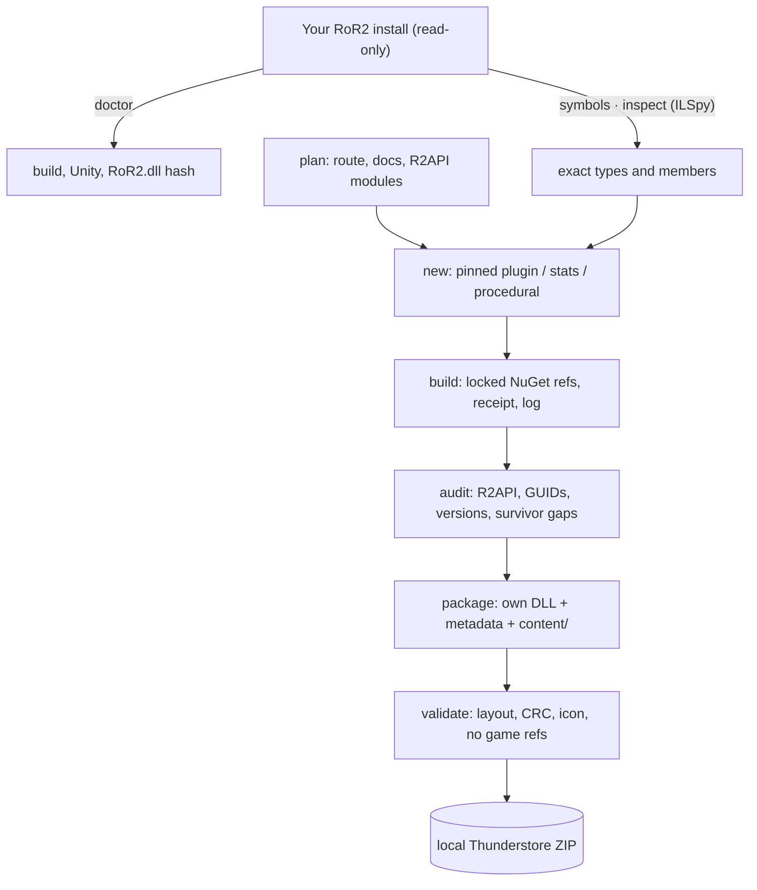

<div align="center">


[](https://github.com/SenjuWoo/Risk-Of-Rain-2-Forge/actions/workflows/ci.yml)
[](https://github.com/SenjuWoo/Risk-Of-Rain-2-Forge/releases/latest)
[](ror2forge/core.py)
[](docs/TOOLCHAIN.md)
[](LICENSE)
[](docs/ROADMAP.md)

**[Install](#install)** · **[Tour](#a-two-minute-tour)** · **[Commands](#commands)** · **[Survivors and assets](#survivors-assets-and-multiplayer)** · **[How it works](#how-it-works)** · **[Changelog](CHANGELOG.md)**

</div>

Risk of Rain 2 Forge is a local, CLI-first workbench for AI agents (and people) making **Risk of Rain 2 mods**. It
reads the game you have installed, finds exact type names in your own `RoR2.dll` through ILSpy, scaffolds pinned
BepInEx/R2API C# templates, compiles them with locked references, audits the result against its manifest and packages
a deterministic Thunderstore ZIP. It needs no always-on service, account, API key or Unity editor for code mods.

**Work in progress.** The CLI, build and package pipeline is tested; generated mods still need in-game validation.
Windows x64 is the supported development platform. Unity asset authoring is a documented optional route, not a
certified editor integration.

Point an agent at this folder and tell it: **"Read AGENTS.md and use this forge to make my Risk of Rain 2 mod."** The
CLI is the default. No MCP is globally registered or automatically launched.

## What you get

- **Names from your game, not from memory.** `symbols` searches the installed `RoR2.dll` (or any DLL) for exact class, struct, enum, interface and delegate names; `inspect` decompiles one type or one member with ILSpy, so an agent never needs a whole-game source dump.
- **A route before any code.** `plan "add a survivor with four skills"` classifies the request and returns only the docs, R2API modules, checks and pitfalls it needs.
- **Templates that build.** `plugin`, `stats` (R2API RecalculateStats movement speed) and `procedural` (runtime geometry, no Unity) compile against pinned NuGet references, with or without a game install.
- **Locked, reproducible builds.** `build --locked --offline` refuses a changed `packages.lock.json`, records source/DLL hashes and keeps a build log and receipt per mod.
- **Packages that hold only your mod.** `package` audits R2API usage, dependency GUIDs and version fields, refuses stale builds, then writes a deterministic ZIP with the mod's own DLL, manifest, README, icon and declared `content/`. Reference DLLs are never packaged.
- **A survivor playbook proven on real ports.** The [character pipeline](docs/CHARACTER_PIPELINE.md) takes another game's character to a playable survivor with skins, without a Unity editor.
- **JSON everywhere.** Every command prints one JSON object; errors exit nonzero. Built for scripts and agents.


## Install

Clone the repository, or download the source kit from the [latest release](https://github.com/SenjuWoo/Risk-Of-Rain-2-Forge/releases/latest).
Each release carries the source ZIP, `SHA256SUMS` and a `BUILD-RECEIPT.json`. Install
[Python 3.11+](https://www.python.org/downloads/) and the [.NET 10 SDK](https://dotnet.microsoft.com/download/dotnet/10.0), then in PowerShell:

```powershell
git clone https://github.com/SenjuWoo/Risk-Of-Rain-2-Forge.git
cd Risk-Of-Rain-2-Forge
.\forge.cmd setup
.\forge.cmd doctor
```

`forge.cmd` is the Windows entry point; `python forge.py` works the same with Python 3.11+. Setup installs pinned
ILSpy, Thunderstore CLI and the official MCP SDK **inside this folder** (`tools/`, `.venv/`), reuses your Python and
.NET SDK, and retains caches so `forge.cmd setup --offline` can restore them later on the same Python/OS/architecture.
Third-party binaries, game files and private caches are not in Git. See [toolchain and provenance](docs/TOOLCHAIN.md)
for pins and limits.

A Steam copy of Risk of Rain 2 is needed for installed-assembly inspection and game testing. Template compilation uses
NuGet references and works without an installed game. Set `ROR2_GAME_DIR` when automatic Steam discovery cannot find it.

## A two-minute tour

```powershell
.\forge.cmd doctor                                   # game build, Unity, assembly hash, SDK and tools
.\forge.cmd plan "add a new survivor with four skills"
.\forge.cmd symbols CharacterBody --limit 10          # exact names from the installed RoR2.dll
.\forge.cmd inspect RoR2.RoR2Application --member 'M:RoR2.RoR2Application.Awake'
.\forge.cmd lookup RiskofThunder R2API_RecalculateStats --version 1.7.0
.\forge.cmd new MyMod --author MyTeam --template stats
.\forge.cmd build MyMod
.\forge.cmd build MyMod --locked
.\forge.cmd package MyMod
.\forge.cmd validate artifacts\MyTeam-MyMod-1.0.0.zip
.\forge.cmd logs --path 'C:\path\to\BepInEx\LogOutput.log'
```


Source lives in `projects/MyMod/src/`; package metadata lives beside it. `artifacts/` receives the checked ZIP.
Generated mods and caches are private and excluded from source tracking. Use `--template stats` for a configurable
movement speed example using R2API's stat event (default multiplier 1.0), or `--template procedural` for
runtime-generated geometry with no Unity editor.


The shots above are real runs, excerpted; `runtime_verified: false` is the forge saying that compiling and packaging are
not proof the mod loads in game.

## Commands

| Command | Purpose |
|---|---|
| `plan "REQUEST"` | Classify a mod request; return only the documents, frameworks, checks and pitfalls it needs |
| `doctor` | Read-only Steam/game/Unity/profile/tool discovery, including game assembly hash |
| `updates` | Query official package feeds on demand; report current pins, scoped candidates and lookup failures |
| `setup [--offline]` | Restore pinned tools into this workspace |
| `new NAME --author TEAM [--template plugin\|stats\|procedural]` | Create an owned mod without replacing source |
| `build NAME [--locked] [--offline]` | Restore and compile, with source/DLL evidence and a build log |
| `symbols QUERY [--assembly DLL] [--limit 20]` | Find exact type names through ILSpy; bounded, case-insensitive output |
| `inspect TYPE [--assembly DLL] [--member ID]` | Decompile one exact type or member using ILSpy |
| `bump NAME patch\|minor\|major\|X.Y.Z` | Back up and update mod version fields together, then rebuild |
| `audit DIR [--findings-limit 12]` | Cross-check R2API usage, dependency GUIDs, the compiled assembly's references and version fields against the manifest; warn on survivor gaps and per-frame work |
| `package NAME [--skip-audit]` | Validate build freshness, run the audit and create a deterministic Thunderstore ZIP |
| `validate ZIP` | Check paths, install layout, metadata, icon integrity, CRC and forbidden game references |
| `release-check [--mode prerelease\|release] [--assets DIR] [--require-verified]` | Compare VERSION, package version, changelog and tag; with `--assets`, verify published bytes and independent CI |
| `logs [--path LOG] [--lines 250]` | Read a bounded log tail and identify triage candidates |
| `lookup NAMESPACE NAME [--version VERSION]` | Read live Thunderstore package metadata and dependencies |
| `guide [overview\|character\|runtime\|audio\|extraction\|thunderstore\|checklist\|tasks\|toolchain\|...]` | Read one playbook. `runtime` is companion aim, buffs and camera. `thunderstore` is the page and dependency minimums |

Normal output is JSON; errors use a nonzero exit. Invalid ZIPs return their JSON report on stdout with exit 1.
`--debug` before the command adds a traceback on stderr. Build logs and receipts live in each mod's `build/` folder.

`symbols` searches classes, interfaces, structs, enums and delegates in the installed RoR2 DLL by default, or a specific
DLL with `--assembly`. It hides compiler-generated helpers, ranks an exact match first and reports truncation, the total
matches and assembly hash. Feed a returned name to `inspect`; no whole-game source dump or persistent index is needed.

### Iterating on a mod

```powershell
.\forge.cmd bump MyMod patch
.\forge.cmd build MyMod --locked --offline
.\forge.cmd package MyMod
```

`bump` checks that forge.json, manifest.json, the project Version and PluginVersion agree before editing them. It
preserves original bytes under the mod's `build/version-backups/`, updates generated state/changelog notes and rolls
back a failed write. Explicit versions must increase. Custom/ambiguous declarations are refused rather than guessed;
the automated version preflight does not support source containing raw C# string delimiters. Existing ZIPs remain
intact; the changed source requires a rebuild. Use an online build when references are not cached yet.

### Doctor, discovery and updates

`doctor` reports build readiness independently of game discovery: the templates can compile with a compatible SDK and
NuGet references on a machine without RoR2. It reports the SDK selected from the forge root, its resolution error if
any, and the separate installed-SDK inventory. A project's own global.json may select another SDK; its build remains
authoritative. Default game inspection still needs the installed assembly. Setup's complete toolchain requires .NET 10
for ILSpy.

Discovery reads Steam's registry/library manifests and r2modman data. Override it with `ROR2_GAME_DIR` /
`ROR2_MODMAN_DIR`, or a private `forge.local.json` containing `game_dir` / `modman_dir`. The manager directory is the
**RiskOfRain2** directory containing `profiles/`. No profile is changed.

Run `forge.cmd updates` when refreshing the workbench or investigating a game/tool update. It checks metadata without
installing anything or changing pins, and covers the tool pins plus the NuGet and Thunderstore pins `forge new` writes
into every mod. Reference candidates stay scoped to the template's loader/Unity line; a newer game reference still
needs compatibility verification. Failed lookups are reported as unknown and produce exit 1, rather than pretending
everything is current. This command has no background schedule and adds no MCP tool.

## Survivors, assets and multiplayer

The [recipes](docs/RECIPES.md) cover items/equipment, survivors/skins/stages, hooks, asset bundles, networking and
debugging. Place produced runtime bundles/audio/etc. in a mod's `content/`; packaging preserves their paths below
`plugins/NAME/`. Code, extra DLLs and nested archives are refused there. The ZIP includes the mod's own DLL, manifest,
README, icon, optional project LICENSE and declared content, rather than the entire build folder.

Building a **playable survivor from another game's assets** has its own end-to-end route: the
[character pipeline](docs/CHARACTER_PIPELINE.md), with [the survivor checklist](docs/SURVIVOR_CHECKLIST.md),
[runtime](docs/RUNTIME.md) (companion aim, buffs, camera), [audio](docs/AUDIO.md) and [extraction](docs/EXTRACTION.md)
notes. It covers source extraction, mesh/rig/clip conversion, baking runtime packs, the minimum working body, skins,
the verified engine facts (including why Unity audio is unavailable) and the failure modes, proven on a 44-skin
character with no Unity editor. A Thunderstore page reads [THUNDERSTORE.md](docs/THUNDERSTORE.md).

There is no survivor template: `new` scaffolds `plugin`, `stats` or `procedural`, and a survivor is built on top of one
by following the pipeline above.

Unity authoring is optional and needs a matching editor and verified EditorKit/ThunderKit setup. Unity itself is not
bundled. Read [the asset route](docs/RECIPES.md#assets-and-unity) before creating an editor project. Runtime shader,
gameplay, save and multiplayer checks require actual game sessions; compilation cannot settle them.

## Optional MCP, off by default

CLI use requires no MCP configuration. If a particular agent host benefits from typed tools/resources, explicitly
start `mcp.ps1` for that task, or configure that host **only in its trusted RoR2 project**:

```json
{
  "command": "<absolute forge path>/.venv/Scripts/python.exe",
  "args": ["-m", "ror2forge.mcp_server"],
  "cwd": "<absolute forge path>"
}
```

This is a server entry example, not a provider-specific full config. Nothing here installs it into personal/global
settings. Eight typed tools and two guide resources expose the original workflow. New `symbols`, `bump` and `updates`
operations use the CLI, keeping this optional schema small. A host must start the server before tools are callable;
stop it when the RoR2 task ends. [The agent guide](docs/AGENT_GUIDE.md) and [reusable skill](skills/ror2-forge/SKILL.md)
work with CLI-only agents too.

## How it works



- **Read-only on the game.** Installed game, manager profiles, saves and supplied references are never written. The forge never installs into a profile, launches the game or uploads to Thunderstore.
- **Pinned and local.** Tools, templates and NuGet/Thunderstore pins are fixed; `updates` reports drift on demand and changes nothing.
- **Evidence stays separate.** Compile, package, loader, gameplay and multiplayer results are different claims. Doctor, new, build, bump, package and validate reports all carry `runtime_verified: false`; the forge never claims a mod runs in game.
- **Refuses to guess.** Stale builds, different bytes under an existing artifact version and ambiguous version declarations are refused, not patched over.

## Validation and boundaries

Run `.venv\Scripts\python.exe -m unittest discover -s tests -v` after setup. MCP tests use a real local SDK
client/server connection. CI also restores/builds all three templates, repeats locked offline builds and checks
deterministic ZIPs on a clean Windows runner without a game install. [VALIDATION.md](VALIDATION.md) distinguishes
development-machine evidence from public CI. Generated examples and evidence files are local outputs, not files shipped
in a clone.

New packages are local candidates. The forge refuses stale builds and different bytes under an existing artifact
version; bump all version fields to create a changed release. Arbitrary custom MSBuild scripts/imports can execute
code: build trusted owned source and record external inputs explicitly.

Releases are source kits: a source ZIP built with `git archive`, `SHA256SUMS` and a build receipt. No forge binaries or
third-party tools are published; setup fetches the pinned tools. Cutting or verifying a release:
[RELEASE_PROCESS.md](RELEASE_PROCESS.md).

See [CONTRIBUTING.md](CONTRIBUTING.md), [the roadmap](docs/ROADMAP.md), [the changelog](CHANGELOG.md) and
[security reporting](SECURITY.md). Original forge code is MIT; bundled third-party tools retain their own terms. Local
installation does not establish permission to redistribute every tool; see [THIRD_PARTY.md](THIRD_PARTY.md).
